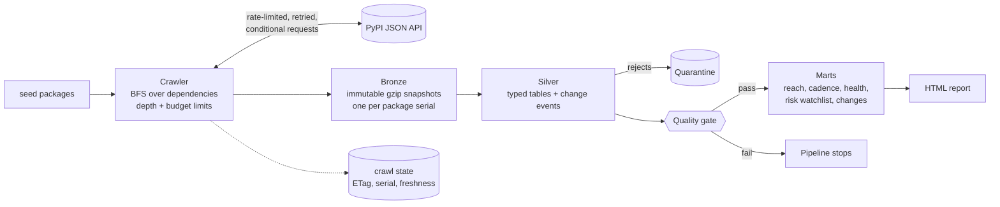

# PyPI Ecosystem Pipeline

An API-to-insight data pipeline. It starts from a handful of seed package names, **discovers the rest of the corpus by crawling the public PyPI JSON API**, lands immutable raw snapshots, builds validated silver tables and SQL marts, gates publication on data-quality checks, and writes a report.

Unlike a synthetic-data exercise, **every number here comes from real PyPI data**. The engineering problems are the ones real sourcing creates: rate limits, transient failures, unchanged data, malformed records, dependency cycles, and a source that changes between runs.

## Architecture



## Quick start

```bash
pip install -e . pytest          # or: pip install -r requirements.txt && export PYTHONPATH=src
python -m pypipe run --root data --seeds config/seeds.txt --max-packages 400
python -m pypipe status --root data
open data/report/ecosystem_report.html
python -m pytest -q              # 16 offline tests, no network needed
```

## Engineering problems this solves

| Problem | Solution | Code | Test |
|---|---|---|---|
| The API rate-limits and fails transiently | Request spacing, retries with exponential backoff and jitter, `Retry-After` honoured, network errors retried | `client.py` | `test_retries_with_backoff_...`, `test_rate_limiter_...` |
| Re-crawling unchanged data wastes the source's bandwidth | Freshness window, then conditional requests (`If-None-Match` with the stored ETag) | `crawl.py` | `test_incremental_crawl_...` |
| A long crawl can die halfway | State checkpointed every 25 packages, so a re-run resumes; snapshots are written atomically | `crawl.py` | `test_incremental_crawl_...` |
| The corpus is not known in advance | Breadth-first discovery over dependencies, with depth and package budgets and de-duplication | `crawl.py` | `test_crawl_respects_depth_...`, `test_crawl_respects_package_budget` |
| Raw data must be replayable and auditable | Immutable snapshots named by PyPI's serial number; a changed serial creates a new file | `crawl.py` | `test_changed_serial_stores_...` |
| Source data is messy | Typed silver tables; invalid records quarantined with the reason (for example releases that have no files) | `silver.py` | `test_end_to_end_quarantine_...` |
| Dependencies form cycles | Recursive SQL with `UNION` de-duplication terminates and still counts transitive dependents | `sql/02_dependency_reach.sql` | `test_end_to_end_quarantine_...` |
| The source changes between runs | Diffs of consecutive snapshots become change events: releases added or yanked, dependencies added or removed | `parse.py`, `silver.py` | `test_snapshot_history_...` |
| Bad data must not reach consumers | Critical checks run **before** the marts are written | `quality.py`, `pipeline.py` | `test_gate_catches_...` |
| Remote calls must be testable | Transport, clock and sleep are injected, so every failure mode is tested offline | `client.py` | all of the above |

## Measured results (real data)

Snapshot taken on 27 Oct 2026 from the public API, in a single-core sandbox container, with 5 requests per second.

| Run | What happened | Time |
|---|---|---|
| 1. Cold | 400 packages discovered from 101 seeds (depth 3); 400 snapshots downloaded (about 44 MB compressed) | 99 s |
| 2. Everything stale | 400 conditional requests, **400 answered "not modified", 0 bodies downloaded** | 85 s |
| 3. Everything fresh | **0 requests** | 7 s |

Run 2 saves the source's bandwidth, not wall-clock time, because the request rate is capped at 5 per second.

**Corpus:** 400 packages, 38,506 releases (272 quarantined for having no files), 280,809 files, 4,036 declared dependencies of which 917 are required, 8 quality checks all passing.

**Sample findings from that snapshot** (corpus-relative, see limitations):
* `typing-extensions` has the largest blast radius: 99 of the 400 packages depend on it transitively, 63 directly.
* 25 packages with at least 5 transitive dependents have not released in over a year, for example `six` (692 days) and `colorama` (1,463 days).
* Latest releases declare support for Python 3.12 in 77.3% of packages and 3.13 in 73.3%.

## Limitations (stated plainly)

* **The corpus is the dependency closure of the seeds, capped at 400 packages.** It is not all of PyPI, and "transitive dependents" means within this corpus.
* **The crawl is sequential on purpose**, to respect the rate limit. Concurrency would not make it faster without exceeding that limit.
* **Python support is declared metadata** (trove classifiers), not tested compatibility.
* **The health score is a transparent heuristic, not a validated model**: 40% recency, 30% release cadence, 30% Python 3.12+ support.
* **Silver is rebuilt from snapshots each run.** Simple and testable; the cost grows with history.
* **Change events appear from the second snapshot onward**, so the first run shows none.
* PyPI is the only source. Download counts are not used.

## What changes at scale

Concurrent workers behind a shared rate limiter and a queue; object storage with an open table format; incremental silver by package; Airflow or Dagster for scheduling; dbt for the SQL models; a second source (npm or crates.io) behind the same client interface.

## Layout

```
src/pypipe/   client.py crawl.py parse.py silver.py gold.py quality.py pipeline.py report.py __main__.py
src/pypipe/sql/   01_release_cadence ... 07_change_summary (run in numeric order)
config/seeds.txt   starting packages
tests/   16 offline tests (a fake PyPI stands in for the network)
.github/workflows/ci.yml   runs the tests on every push
```

The crawler identifies itself with a descriptive User-Agent and stays well under any reasonable request rate.
